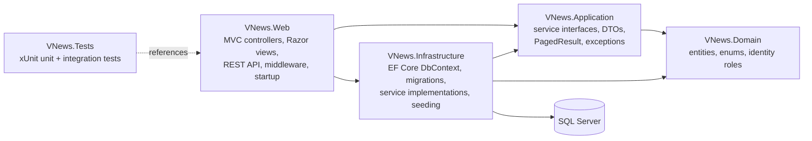

# VNews — Vietnamese News Platform

A full-stack news website and editorial CMS built with **ASP.NET Core MVC (.NET 10)**, **EF Core** and **SQL Server**.

Readers browse, search, comment and save articles; journalists write and submit stories; editors review and publish; admins manage categories, users and moderation, all backed by a real SQL Server database and role-based security.

### Live Demo

**[ Visit VNews — Live Website](https://vnews-szero.somee.com/)**

Explore the Vietnamese news platform and its editorial CMS.


> The public site and the CMS interface are in Vietnamese. This README and the code identifiers are in English; some guides under `docs/`, `RUN-WINDOWS.md` and a number of code comments are written in Vietnamese.


## Table of contents

1. [Project overview](#project-overview)
2. [Tech stack](#tech-stack)
3. [Key features](#key-features)
4. [Architecture](#architecture)
5. [Project structure](#project-structure)
6. [Getting started](#getting-started)
7. [Configuration](#configuration)
8. [Testing](#testing)
9. [Deployment](#deployment)
10. [Security notes](#security-notes)
11. [Known limitations](#known-limitations)
12. [Further documentation](#further-documentation)

## Project overview

VNews is a portfolio project that behaves like a small real newsroom product rather than a static mock-up:

- **Server-rendered public site** (Razor views) with a layout and information density in the style of a Vietnamese news portal, under independent VNews branding.
- **Editorial workflow** enforced on the server: *Draft → Pending review → Published / Rejected*, with audit logging and optimistic concurrency.
- **Real data everywhere.** All public content is read from SQL Server through EF Core. There are no hard-coded runtime arrays and no in-memory or SQLite database.
- **Versioned REST API** (`api/v1`) alongside the MVC site, including endpoints backed by parameterized SQL Server stored procedures.
- **Deployable configuration.** Production start-up never seeds sample content, cookies are `Secure` in Production, and a deployment guide and package scripts are included.

The project is **not deployed at a public URL yet**; the repository contains everything needed to run it locally and a documented path to host it (see [Deployment](#deployment)).

## Tech stack

| Area | Technology |
|---|---|
| Runtime / language | .NET 10, C# |
| Web | ASP.NET Core MVC, Razor views, REST API controllers, Tag Helpers, View Components |
| Data access | Entity Framework Core 10 (code-first migrations), LINQ with projections |
| Database | SQL Server / SQL Server LocalDB, 2 parameterized stored procedures, indexes on slug and `(Status, PublishedAt)` |
| Identity & security | ASP.NET Core Identity, role-based authorization, antiforgery, HtmlSanitizer, rate limiting, security headers |
| Front end | Server-rendered HTML, hand-written CSS and vanilla JavaScript modules (no SPA framework, no Node backend) |
| Testing | xUnit, `Microsoft.AspNetCore.Mvc.Testing` (integration tests against real SQL Server), Playwright (browser/visual tests) |
| CI | GitHub Actions workflow (`windows-latest`, LocalDB) — defined in `.github/workflows/ci.yml` |

NuGet packages are kept minimal: EF Core SQL Server provider, Identity EF Core stores, `HtmlSanitizer`, and the test packages.

## Key features

### Public site (readers)
- Home page with top story, side features, latest list, per-category blocks, "most viewed" sidebar and category navigation.
- Category pages (parent categories include their sub-categories), tag pages, article pages with related stories, previous/next navigation, share, font-size controls and a **"listen to the article"** button (browser speech synthesis; reads title, summary and body).
- Search over title and summary with filters (category, period, kind) and paging; friendly 404 and empty states.
- Reader accounts: sign in/register, **saved articles** (bookmarks) and **comments** with replies.
- Weather widget with real data from the free Open-Meteo service; it hides itself if the call fails instead of showing made-up numbers.
- Responsive layout verified at desktop (1440 px), tablet (768 px) and mobile (390 px) widths.

### Editorial CMS (`/cms`)
- **Role-based access:** Admin, Editor, Author, Reader. Authors see and edit their own drafts; editors review and publish; admins manage everything.
- **Workflow:** submit for review, publish, reject with a reason; invalid transitions are rejected by the service layer.
- **Rich article editor** with HTML sanitization, cover image with caption, image gallery, and pasting formatted content from other pages — pasted pictures are fetched server-side and stored on this site (with a guard that only connects to public IP addresses, limited redirects, size and time limits).
- **Soft delete (trash)** with restore; admins can delete trashed articles permanently (with a confirmation step).
- **Optimistic concurrency** (`RowVersion`) so two editors cannot silently overwrite each other.
- **Comment moderation**, **user administration** (roles, lock/unlock), **category management** (with parent/child categories), an admin tool that finds uploaded cover images no article uses and quarantines them (it never deletes), and an **audit log** of every write action.
- **Statistics page** based on real, anonymous reading data: first-party view tracking with a daily hashed visitor id, bots ignored and short-window de-duplication.
- Admin-only **RSS headline import** (title, short summary, date and a link back; the source is named on every imported item; full article text is never copied).

### REST API (`/api/v1`)
| Endpoint | Purpose |
|---|---|
| `GET /api/v1/articles`, `GET /api/v1/articles/{slug}` | Paged published articles, single article |
| `GET /api/v1/categories`, `/{slug}` | Categories |
| `GET /api/v1/categories/{slug}/articles` | Published articles of a category via stored procedure `dbo.sp_GetPublishedArticlesByCategory` |
| `GET /api/v1/search` | Keyword search with paging |
| `GET /api/v1/stats/daily-publish` | Publications per day via stored procedure `dbo.sp_GetDailyPublishStats` |

Unpublished articles are never exposed by the API; errors are returned in a consistent format by a global exception handler.

## Architecture

VNews is a **modular monolith** with four layers and a separate test project. Dependencies point inwards towards the domain.



- **Domain** — entities (`Article`, `Category`, `Tag`, `ArticleTag`, `ArticleImage`, `Comment`, `SavedArticle`, `ArticleView`, `AuditLog`), the `ArticleStatus` enum and the Identity user/roles.
- **Application** — contracts only: service interfaces (`IArticleQueryService`, `IArticleCommandService`, `IArticleTrashService`, …), DTOs, `PagedResult<T>` and domain exceptions. No EF Core dependency.
- **Infrastructure** — `VNewsDbContext`, entity configurations, 11 EF Core migrations (including the stored procedures), service implementations, idempotent seeding, Identity wiring.
- **Web** — thin controllers, Razor views, view components, API controllers, security-header middleware, rate limiting, and the composition root (`Program.cs`, `Startup/`).

Controllers call services; services use EF Core/LINQ (projecting to DTOs) or stored procedures; the workflow rules and audit logging live in the service layer rather than in controllers.

## Project structure

```text
VNews.slnx
├── src/
│   ├── VNews.Domain/            # Entities, enums, identity roles
│   ├── VNews.Application/       # Interfaces, DTOs, common types
│   ├── VNews.Infrastructure/    # DbContext, migrations, services, seeding
│   └── VNews.Web/               # MVC + API, views, wwwroot, startup
│       ├── Controllers/         # Public, CMS and Api/ controllers
│       ├── Views/               # Razor views (public site + CMS)
│       ├── Middleware/          # Security headers, API exception handler
│       ├── Startup/             # DI, rate limiting, initialization
│       └── wwwroot/             # CSS, JavaScript, static images
├── tests/
│   └── VNews.Tests/             # xUnit unit and integration tests
├── visual-tests/                # Playwright browser tests (TypeScript)
├── docs/                        # Scope, design notes, deployment guide
├── .github/workflows/ci.yml     # CI definition
└── RUN-WINDOWS.md               # Detailed local run guide (Vietnamese)
```

## Getting started

### Prerequisites
- Windows with the **.NET 10 SDK** (`dotnet --version` should print `10.0.x`)
- **SQL Server LocalDB** (`sqllocaldb info` should list `MSSQLLocalDB`); it ships with Visual Studio or SQL Server Express LocalDB
- Optional: Node.js 20+ for the Playwright tests

### Run locally
```powershell
git clone <your-fork-or-repository-url>
cd VNews-Optimized-Claude-Code-Kit
dotnet build VNews.slnx
cd src\VNews.Web
dotnet run
```

On first start in the **Development** environment the app applies EF Core migrations (creating the `VNewsDb` LocalDB database if needed) and seeds idempotent sample content: original, fictional Vietnamese demo articles and categories, plus the roles and sample accounts for trying each role. Open the URL printed in the console (the launch profile uses `http://localhost:5298` / `https://localhost:7121`).

Useful routes: `/` (home), `/chuyen-muc/{slug}` (category), `/tin/{slug}` (article), `/tim-kiem?q=` (search), `/tai-khoan/dang-nhap` (sign in), `/cms` (newsroom, requires sign-in), `/api/v1/articles` (API).

The sample accounts and an optional one-click role demo are described in [`RUN-WINDOWS.md`](RUN-WINDOWS.md). The one-click demo is **off by default** and only works in Development, on a loopback request, against databases whose names start with `VNewsDemo`, `VNewsE2E` or `VNewsTests_`.

## Configuration

Settings live in `src/VNews.Web/appsettings.json` and can be overridden by environment variables (use `__` for nesting). Do not commit secrets; `appsettings.Development.json` is git-ignored.

| Setting | Purpose |
|---|---|
| `ConnectionStrings:DefaultConnection` | SQL Server connection string (default: LocalDB `VNewsDb`, Windows authentication) |
| `Seed:SampleContent` | Seed demo content. Defaults to **on only in Development**; leave unset in Production |
| `Bootstrap:AdminEmail` / `Bootstrap:AdminPassword` | Create the first admin on a fresh deployment (only when no admin exists; remove afterwards) |
| `Uploads:RootPath` | Folder for uploaded images; use a persistent, writable folder outside the app directory in Production |
| `DataProtection:KeysPath` | Persistent folder for cookie/antiforgery keys |
| `AllowedHosts` | Host names the site answers to (set to the real domain in Production) |
| `RateLimiting:Auth:PermitLimit` / `WindowSeconds` | Sign-in rate limit |
| `DemoAuth:Enabled` | One-click role demo (default `false`; Development only) |
| `NewsImport:ShowSourceThumbnails` | Show publisher thumbnails on imported headlines (off by default) |
| `Features:ShowDemoAdSlot` | Show the house-campaign banner slot on the home page |
| `ASPNETCORE_FORWARDEDHEADERS_ENABLED` | Set to `true` when running behind a TLS-terminating proxy |

## Testing

```powershell
dotnet test VNews.slnx
```

- **xUnit unit tests** cover pure logic (paging, search text, reading time, RSS parsing, image validation, error mapping, Vietnam time).
- **Integration tests** use `WebApplicationFactory` against **real SQL Server LocalDB** with an isolated database per test fixture (no mocked or in-memory database). They cover the editorial workflow, role permissions, public/API behavior, comments, bookmarks, analytics, trash and permanent deletion, security headers, rate limiting, Production start-up rules and more.
- **Playwright** browser tests live in `visual-tests/` (layout at 1440/768/390 px, navigation, CMS flows, article page). They start their own server on port 5399 with a dedicated `VNewsE2E` database:

```powershell
cd visual-tests
npm install
npx playwright install chromium
npx playwright test                                            # main suite
npx playwright test -c playwright.subcategories.config.ts      # sub-category suite
```

Latest local run: **441 xUnit test cases passed**, the main Playwright suite has 199 tests and the sub-category suite 15. The CI workflow is defined but **has not been executed on GitHub yet**.

## Deployment

`docs/DEPLOY-HOSTING.md` (Vietnamese) describes how to move the application, its database and its uploaded images to a Windows/SQL Server host. In short:

1. Publish the app: `dotnet publish src/VNews.Web -c Release` (the output includes a `web.config` for IIS-style hosting).
2. Create the database on the host (restore a `.bak` or let the app create the schema on an empty database) and set the environment variables from [Configuration](#configuration).
3. Copy uploaded images into the folder set by `Uploads:RootPath`.
4. Start the app. In Production it applies migrations and creates the roles but **does not seed any sample content**; the first admin is created from `Bootstrap:*`, which should then be removed.
5. Serve it over **HTTPS**. In Production the sign-in and antiforgery cookies are `Secure`, so plain-HTTP requests will not work by design.

`docs/deploy/refresh-package.ps1` builds a transfer package (database backup plus the images referenced by content) from a local database, and `docs/deploy/post-restore-secure-accounts.sql` locks sample accounts on a restored database.

## Security notes

- Role-based authorization on every CMS mutation; ownership checks for authors; workflow rules enforced server-side.
- Antiforgery validation on form posts; server-side input validation; parameterized queries (EF Core and `SqlParameter` for stored procedures).
- Article HTML is sanitized with an allow-list before saving; uploaded images are validated (size limit, content check, random file names) and re-validated when imported from a URL.
- Security headers (CSP, `X-Content-Type-Options`, `Referrer-Policy`, HSTS outside Development), `HttpOnly` cookies, `Secure` cookies in Production, sign-in rate limiting and an Identity password policy.
- Optimistic concurrency and an audit log for write actions.
- Sample accounts exist only in seeded Development databases; no credentials or connection secrets are stored in the repository.

## Known limitations

- No public deployment or live demo URL yet; the CI workflow has not run on GitHub.
- SEO is minimal: a meta description is set, but there is no sitemap, `robots.txt` or Open Graph metadata.
- No caching layer, background job queue or container setup; the project targets a single-instance Windows/SQL Server host.
- No license file is included yet.
- The UI language is Vietnamese only.

## Further documentation

| File | Content |
|---|---|
| [`RUN-WINDOWS.md`](RUN-WINDOWS.md) | Detailed local setup, routes, API and demo-mode instructions (Vietnamese) |
| [`docs/SCOPE.md`](docs/SCOPE.md) | Milestones and acceptance criteria |
| [`docs/FEATURE-MAP.md`](docs/FEATURE-MAP.md) | Skill-to-code map (some paths may predate later refactors) |
| [`docs/DEPLOY-HOSTING.md`](docs/DEPLOY-HOSTING.md) | Hosting and data-transfer guide (Vietnamese) |
| [`docs/PROGRESS.md`](docs/PROGRESS.md) | Development log and verification history |

## Content and attribution

Demo articles are original and fictional. Layout and density take inspiration from Vietnamese news portals, but VNews uses its own branding and does not copy any publisher's logos, article text, images, HTML or CSS. Headlines imported through the optional admin RSS feature contain only a title, short summary, date and a link back to the original, with the source named.
